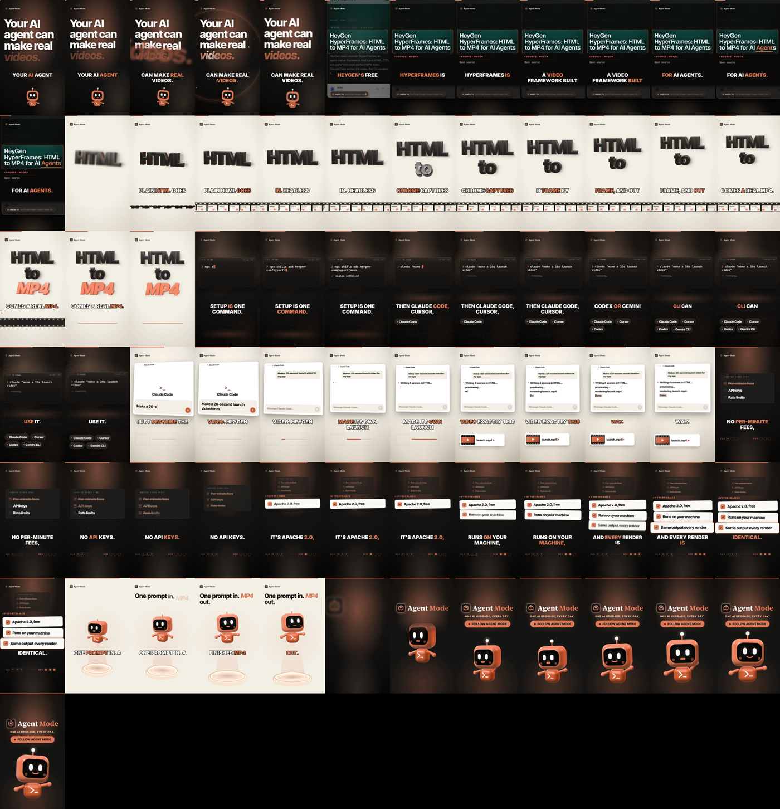

# viral-shorts-kit 🎬

**Turn any link into a cinematic, narrated YouTube Short with one command in Claude Code.**

```
/video https://github.com/some/repo
```

Claude researches the source, writes the script, screenshots the real page, voices it locally, animates it with 3D shots in [Remotion](https://remotion.dev), gets an independent AI review, fixes what the review finds and hands you an upload-ready MP4.

<p align="center">
  
  <br/><a href="docs/demo.mp4">▶ Watch the full demo with sound (36 s)</a>
</p>



## What's in a video

| Beat | Shot | What it does |
|---|---|---|
| Hook | `HookSlam` | The claim is readable on frame 0 (your thumbnail), then the key word slams in on the voice |
| The news | `NewsPage` | A **real screenshot** of the article, with a crash zoom onto the headline and the key phrase highlighted as it's spoken |
| The idea | `Type3D` | **WebGL** extruded 3D words with bevels, rim light and a filmstrip |
| A command | `Terminal3D` | Terminal windows in 3D space; the camera flies between them, with human-rhythm typing and tool chips |
| A prompt | `ChatPrompt` | A close-up on the prompt typing, then a pull back as the reply streams in and a file tile pops out |
| Old vs new | `CompareStack` | Pain points strike off as they're named, and the wins land in 3D |
| Personality | `Mo3D` | A 3D mascot who talks while the voice speaks |
| End card | `OutroLockup` | Logo lockup, a FOLLOW button and a poster frame |

Also included:
- word-synced subtitles,
- a local **Kokoro** voiceover with Whisper word timing and pauses tightened to Shorts pace,
- an original royalty-free music bed,
- CC0 sound effects,
- -14 LUFS mastering.

## Quick start

You need [Claude Code](https://claude.com/claude-code), Node 20+, Python 3.10+ and FFmpeg on your PATH.

```bash
git clone https://github.com/omsenjalia/viral-shorts-kit && cd viral-shorts-kit
npm i
pip install -r requirements.txt
```

Download the Kokoro voice model (~330 MB) into `models/`:

```bash
mkdir -p models && cd models
curl -LO https://github.com/thewh1teagle/kokoro-onnx/releases/download/model-files-v1.0/kokoro-v1.0.onnx
curl -LO https://github.com/thewh1teagle/kokoro-onnx/releases/download/model-files-v1.0/voices-v1.0.bin
cd ..
```

The Whisper timing model and the few sound effects download themselves on the first build.

Then open Claude Code in the folder:

```
/video https://some-article-or-repo
/video "Claude Code hooks" --long    # 16:9 explainer
/video <link> --both                 # Short + long-form
```

Output lands in `out/<slug>/`: the MP4, a thumbnail, contact sheets and `upload.md` (title, description, hashtags). **It never uploads anything for you.**

### Rebuild the demo yourself

```bash
node scripts/capture.mjs hyperframes-open-source https://www.noqta.tn/en/blog/heygen-hyperframes-html-to-mp4-ai-agent-video-2026
node scripts/build.mjs hyperframes-open-source
```

## Make it yours

- **Brand:** `brand-template/brand.ts` holds the colors and fonts, plus a logo, the Mo mascot, a banner and a channel icon. The kit ships with my channel's brand, *Agent Mode*. Swap in your own.
- **Taste:** `.claude/skills/video/references/lessons.md` is where your verdicts go ("hook too slow", "love the terminal"). The skill reads them on every run, so videos drift toward your taste.
- **New shots:** port any of the 124 shot cards in `.claude/skills/video/shotcraft/` into `src/shots/<Name>.shot.tsx` (contract in `src/shots/README.md`). New shots register automatically, and you can preview one with the `ShotLab` composition.

## How it's built

```
.claude/skills/video/       the /video skill: pipeline, craft rules, lessons, scene catalog
  shotcraft/                vendored video-shotcraft (shot cards, tuned demos, sound + review guides)
src/shots/                  ported cinematic shots (one file each, auto-registered)
src/sc/                     shotcraft's visual system, re-skinned (looks, camera, page cam, 3D helpers)
src/Episode.tsx             scene sequencing, grounds, push-through cuts, subtitles
scripts/                    voice.py (Kokoro), music.py, capture.mjs, build.mjs, fetch-sfx.mjs
brand-template/             brand tokens, logo, mascot, banner
episodes/<slug>.json        one script per video
```

## Credits and licenses

- **[video-shotcraft](https://github.com/Vincentwei1021/video-shotcraft)** by Vincent Wei (Apache-2.0) is the shot library, visual system and review method this kit is built on. Its audio is referenced, not redistributed (see its `assets/audio/ATTRIBUTION.md`).
- **Inspiration:** [latent-spaces/brag](https://github.com/latent-spaces/brag), [timscheuerai/launch-video-kit](https://github.com/timscheuerai/launch-video-kit), [feitangyuan/onetake](https://github.com/feitangyuan/onetake) and [Leonxlnx/cinetic](https://github.com/Leonxlnx/cinetic).
- **Rendering:** [Remotion](https://remotion.dev) is free for individuals and small teams; companies may need a [Remotion license](https://remotion.dev/license).
- **Voice:** [Kokoro](https://github.com/thewh1teagle/kokoro-onnx) (Apache-2.0); word timing via [faster-whisper](https://github.com/SYSTRAN/faster-whisper).
- **Sound effects:** [Kenney](https://kenney.nl) (CC0). A few Mixkit effects are fetched at build time under the [Mixkit free license](https://mixkit.co/license/#sfxFree).
- **Font:** Inter Tight (OFL).

This kit's own code is Apache-2.0 (see `LICENSE` and `NOTICE`). It's an independent project, not affiliated with Anthropic, HeyGen or Remotion.
